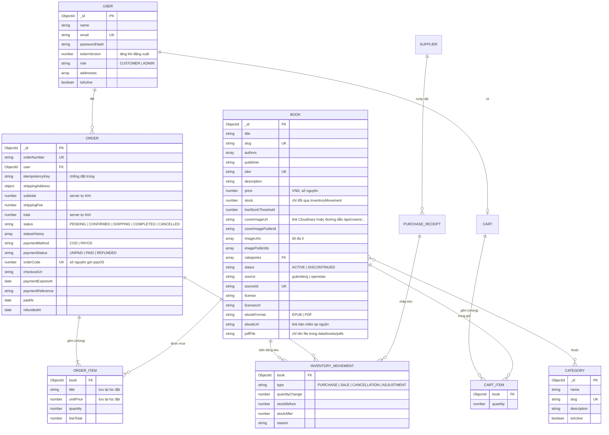
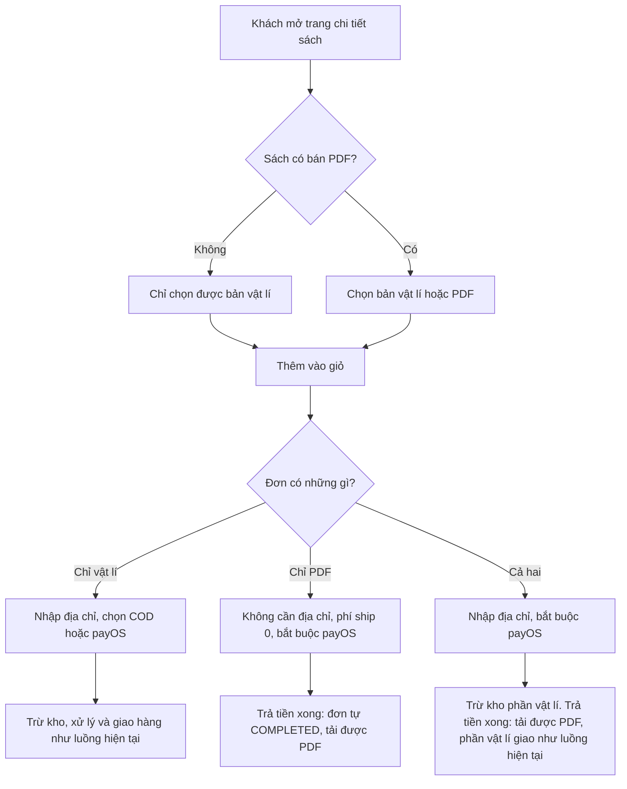
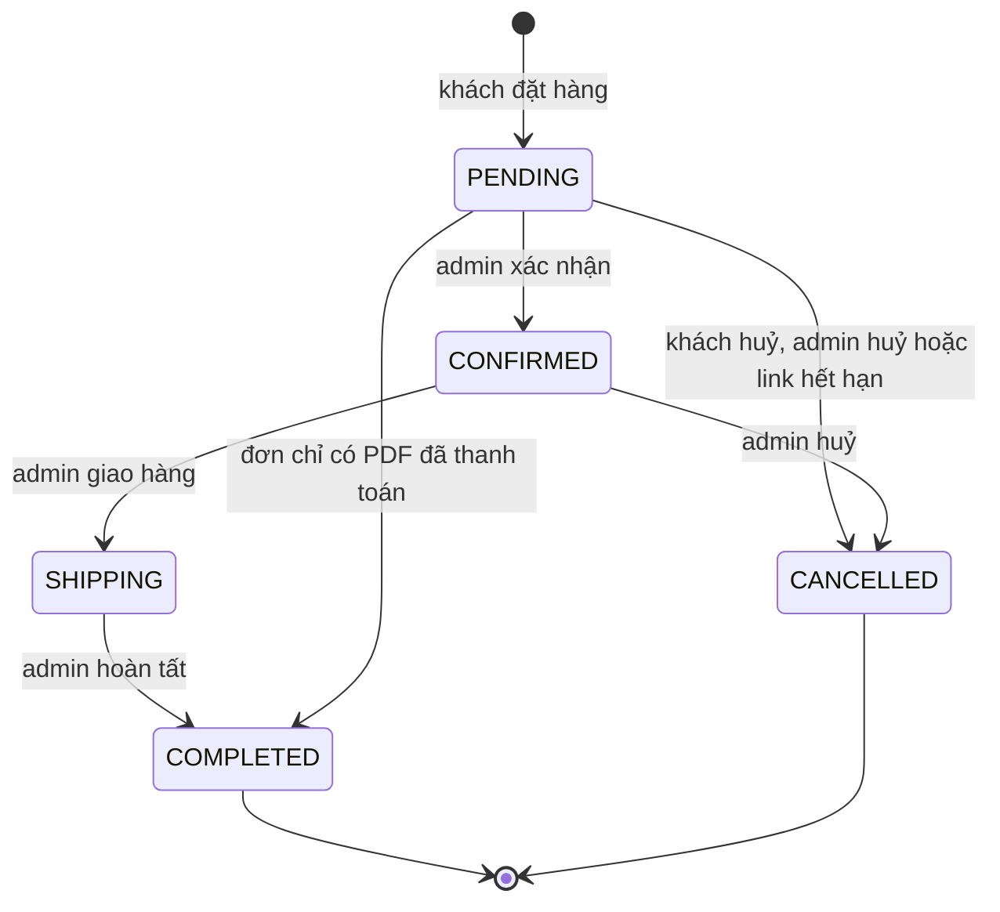
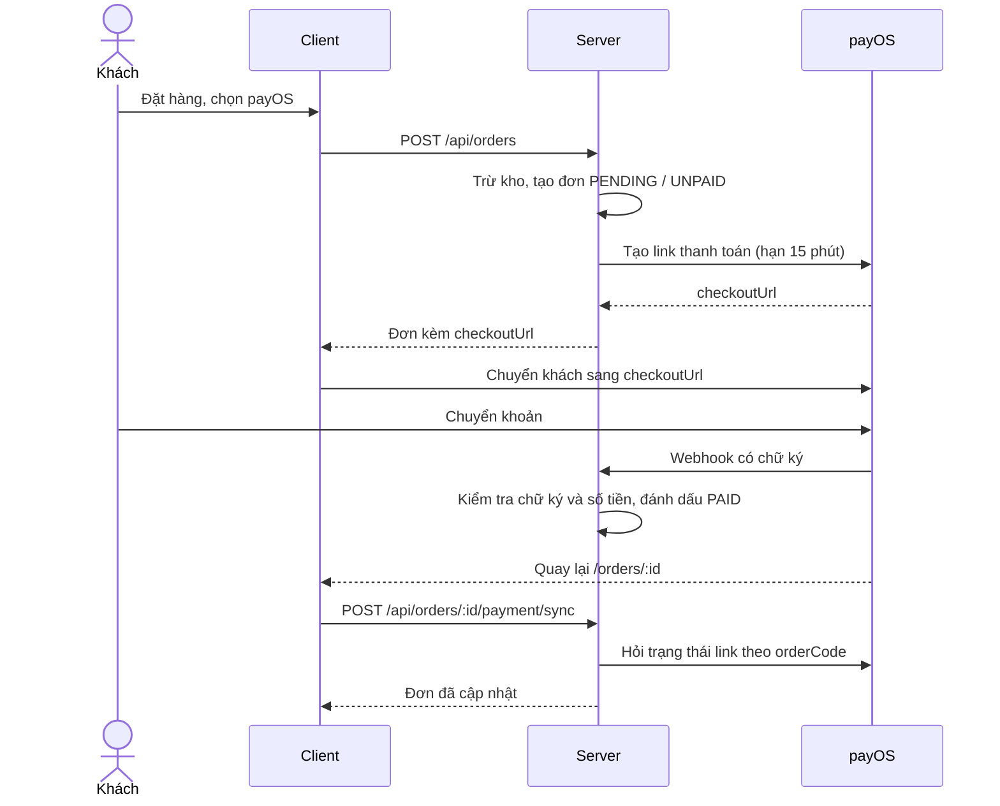

# Bookstore: Context dự án

Website quản lí mua bán sách online, dùng MERN stack (bài assignment SDN302).

Tài liệu liên quan: [server/API.md](server/API.md) (chi tiết endpoint), [server/README.md](server/README.md) (cách chạy), [client/UI_DESIGN_GUIDELINES.md](client/UI_DESIGN_GUIDELINES.md) (chuẩn giao diện).

## 1. Yêu cầu gốc

- Xây dựng một website giúp chủ cửa hàng bán sách quản lí việc mua và bán sách.
- Trang web hiển thị danh mục sách một cách trực quan và sinh động.
- Các thao tác bán và làm đơn order mua sách đều thực hiện trực tuyến.
- Chủ cửa hàng có thể chỉnh sửa thông tin liên quan đến sách.

## 2. Cấu trúc

```text
assignment/
├── context.md
├── server/
│   ├── index.js          khởi động, chạy quét đơn hết hạn mỗi phút
│   ├── app.js            cấu hình Express
│   ├── config/db.js
│   ├── lib/http.js       validate input, phân trang, HttpError
│   ├── models/           User, Category, Book, Order, Cart, Supplier, PurchaseReceipt, InventoryMovement
│   ├── middleware/       auth (requireAuth, requireAdmin, rateLimit), error
│   ├── controllers/      auth, category, book, order, payment, upload, cart, supplier, receipt, report, resource
│   ├── services/         commerce (đơn, kho, nhập hàng), payos (tạo link, sync, huỷ link, quét đơn hết hạn),
│   │                     cloudinary (ký, xoá ảnh)
│   ├── routes/index.js
│   ├── scripts/          init-db, seed (tạo admin, danh mục và sách mẫu, tải ảnh mẫu lên Cloudinary), check-cloudinary,
│   │                     fetch-books (lấy dữ liệu, bìa, PDF), import-books (đưa catalog vào MongoDB)
│   ├── data/books/       catalog.json, covers/<nhóm>/<thể loại>/, pdfs/ (git bỏ qua)
│   └── test/
└── client/src/
    ├── api.js            wrapper fetch tự gắn token, useApi, uploadImage
    ├── context/          AuthContext, CartContext, CatalogContext
    ├── components/       Navbar, BookCard, ProtectedRoute, ui, HomeSections, Billboard, Footer
    └── pages/            Home, BookDetail, Auth, Cart, Checkout, Orders, admin/
```

## 3. Vai trò

| Vai trò | Quyền |
|---|---|
| **Khách** (chưa đăng nhập) | Xem, tìm kiếm, lọc, sắp xếp sách |
| **Khách hàng** (`CUSTOMER`) | Giỏ hàng, đặt hàng, thanh toán, xem và huỷ đơn của mình |
| **Chủ cửa hàng** (`ADMIN`) | Quản lí sách, ảnh, danh mục, tồn kho, đơn hàng; xem thống kê |

Đăng ký luôn tạo `CUSTOMER`. Tài khoản `ADMIN` chỉ được tạo bằng `npm run db:seed`.

## 4. Chức năng

| Khu vực | Trạng thái | Chức năng |
|---|---|---|
| Danh mục sách | Có màn hình | Lưới sách có ảnh bìa, skeleton khi tải, tìm kiếm, lọc theo danh mục, sắp xếp, phân trang, trang chi tiết có thư viện ảnh |
| Tài khoản | Có màn hình | Đăng ký, đăng nhập, đăng xuất |
| Mua hàng | Có màn hình | Giỏ hàng lưu trên server, đặt hàng, COD hoặc payOS, lịch sử đơn, huỷ đơn, thanh toán tiếp |
| Quản trị | Có màn hình | Thêm, sửa, ẩn sách; tải ảnh; điều chỉnh tồn kho; danh mục; xử lý đơn; ghi nhận thu COD và hoàn tiền; thống kê |
| Nhập hàng | Chỉ có API | Nhà cung cấp, phiếu nhập, nhật ký kho (xem câu hỏi 1 ở phần 10) |
| Bản mềm PDF | Có màn hình | Chọn mua bản vật lí hoặc PDF, tải PDF sau khi thanh toán (xem "Bán sách theo định dạng" ở phần 6) |

**Không làm:** cổng thanh toán khác, hoàn tiền tự động, refresh token, đánh giá sách, mã giảm giá, quên mật khẩu, gửi email, nhiều chi nhánh.

Nội dung trang chủ như banner, bài viết, logo đối tác vẫn là dữ liệu mẫu của template. Giao diện đang bằng tiếng Anh theo `UI_DESIGN_GUIDELINES.md`.

## 5. ERD



**Dữ liệu sách đã nhập:** database chỉ lưu đường dẫn và link, không lưu file. Bìa được phục vụ qua `/api/covers/`, còn thư mục `pdfs/` không mở công khai. `npm run db:import` nhập 140 sách văn học (Project Gutenberg) và 73 giáo trình (OpenStax, 48 cuốn có `pdfFile`), chạy lại không đổi sách đã có. Giá trong dữ liệu này là giá mẫu, tồn kho ban đầu 20 chưa có dòng `InventoryMovement` tương ứng.

`SUPPLIER` và `PURCHASE_RECEIPT` chỉ dùng cho nhập hàng, chi tiết trường nằm trong `server/models/`.

Các trường phục vụ bán PDF:

| Model | Thay đổi |
|---|---|
| `BOOK` | Thêm `pdfFile` (tên file trong thư mục PDF, không bao giờ trả ra API công khai), `pdfPrice`, `pdfForSale`. `price` và `stock` vẫn là của bản vật lí |
| `CART_ITEM`, `ORDER_ITEM` | Thêm `format: PHYSICAL \| PDF`, mặc định `PHYSICAL` cho dữ liệu cũ. Mỗi dòng phân biệt theo cặp `book` + `format` |
| `ORDER` | `shippingAddress` chỉ bắt buộc khi đơn có bản vật lí |

## 6. Quy tắc nghiệp vụ

### Bán sách theo định dạng

Mọi sách đều có bản vật lí. Chỉ sách có `pdfForSale: true` mới bán thêm bản mềm PDF.



| | Bản vật lí | Bản PDF |
|---|---|---|
| Giá | `price` | `pdfPrice` |
| Số lượng mỗi dòng | Từ 1 trở lên | Luôn là 1 |
| Tồn kho | Trừ, hoàn và ghi `InventoryMovement` | Không dùng kho |
| Địa chỉ, phí ship | Bắt buộc | Không cần |
| Thanh toán | COD hoặc payOS | Chỉ payOS |
| Nhận hàng | Admin xử lý và giao | Tải về sau khi `PAID` |

**Giỏ hàng và đặt đơn**

- Một sách có thể nằm ở hai dòng trong giỏ: một bản vật lí và một PDF.
- Mỗi đơn có thể gồm cả hai định dạng, không tách đơn. Đơn có PDF dùng COD thì trả `400`.
- Khi đặt đơn, server kiểm tra lại `pdfForSale`, kiểm tra file PDF có tồn tại và lấy `pdfPrice` từ DB. Thiếu file thì trả `409`, để khách không trả tiền cho thứ không tải được. `format` được tính vào `requestHash` của `Idempotency-Key`.
- Đã có PDF đó trong một đơn `PAID` chưa huỷ, hoặc trong một đơn `PENDING` đang chờ trả tiền, thì không mua lại được, trả `409 ALREADY_OWNED`.
- Phí ship chỉ tính khi đơn có ít nhất một bản vật lí.

**Thanh toán và trạng thái**

- Webhook và sync vẫn dùng chung một update có điều kiện `paymentStatus: 'UNPAID'`.
- Đơn chỉ có PDF và đang `PENDING`: cùng update đó chuyển luôn sang `COMPLETED` và ghi `completedAt`, không cần admin xử lý. Nhờ vậy doanh thu vẫn tính theo quy tắc `COMPLETED` + `PAID`.
- Đơn chỉ có PDF không đi qua `CONFIRMED` hay `SHIPPING`. Server từ chối nếu admin chuyển sang hai trạng thái này.
- Đơn có cả hai định dạng: trả tiền xong tải được PDF ngay, đơn vẫn chờ admin xử lý phần giao hàng.
- Huỷ đơn và đơn hết hạn chỉ hoàn kho các dòng vật lí.
- Đơn được huỷ theo cả đơn, không huỷ riêng từng dòng. Admin huỷ đơn đã trả tiền thì khách mất quyền tải PDF, và đơn vào hàng chờ hoàn tiền như hiện tại.
- Tiền về sau khi đơn đã huỷ: đơn giữ `CANCELLED` + `PAID`, khách không tải được PDF, admin hoàn tiền thủ công.
- Đơn chỉ có PDF đã `COMPLETED` không huỷ và không hoàn tiền được trong hệ thống, vì `COMPLETED` là trạng thái cuối (xem câu hỏi 4 ở phần 10).

**Lưu và tải PDF**

Tạm thời lưu ngay trong dự án, không dùng Cloudinary (xem câu hỏi 5 ở phần 10).

- File nằm ở `server/data/books/pdfs/`, đặt tên `<id>.pdf`. Thư mục này đã nằm trong `.gitignore` và là nơi `npm run books:fetch -- --pdf` tải PDF về. Sau khi clone dự án phải tải hoặc chép lại file.
- `app.js` chỉ phục vụ tĩnh thư mục `covers/`, và không được mở thư mục PDF bằng `express.static`. Cách duy nhất để lấy PDF là API tải bên dưới.
- Chưa có màn hình tải PDF lên. File được chép vào thư mục bằng tay hoặc bằng script, rồi admin điền `pdfFile`, `pdfPrice` và bật `pdfForSale`. Server chỉ nhận tên khớp `^[a-z0-9-]+\.pdf$`, để không đọc được file ngoài thư mục, và từ chối bật bán nếu file không tồn tại.
- Khách tải qua `GET /api/orders/:id/items/:bookId/download`, gửi kèm JWT. Server chỉ gửi file khi người gọi là chủ đơn, dòng đó là PDF, đơn `PAID` và chưa `CANCELLED`. Không giới hạn số lần tải.
- Server gửi file trực tiếp bằng `res.download`, không dùng link tạm. Client gọi bằng `fetch` có token rồi lưu file từ blob, vì `<a href>` không gửi được JWT.
- File bị mất sau khi khách đã trả tiền thì API trả `404`, ghi log để admin chép lại. Đơn không đổi trạng thái.
- Admin ngừng bán bằng `pdfForSale: false`, hoặc ẩn sách: người đã mua vẫn tải được, nên không xoá file.
- Thay file bằng cách ghi đè cùng tên: người đã mua tải được bản mới.
- File đã tải về không được bảo vệ thêm. Chưa làm DRM hay đóng dấu theo người mua.
- Lưu trên ổ đĩa nên chỉ chạy được một instance, và file sẽ mất nếu hosting không có ổ đĩa lâu dài.

### Trạng thái đơn hàng



- Server từ chối mọi chuyển trạng thái không có trong sơ đồ.
- Đơn `PAYOS` chưa thanh toán không được `CONFIRMED`.
- Khách không tự huỷ được đơn đã thanh toán, chỉ admin mới huỷ được.
- Đơn COD do admin bấm ghi nhận đã thu tiền, khi đơn đang `SHIPPING` hoặc đã `COMPLETED`. Đơn `PAYOS` không ghi nhận tay được.
- Doanh thu chỉ tính đơn `COMPLETED` và `PAID`.

### Đặt hàng và tồn kho

- Client chỉ gửi `book` và `quantity`. Server tự lấy giá từ DB và tính tổng tiền.
- Trừ kho, hoàn kho và ghi `InventoryMovement` nằm trong một transaction, nên **MongoDB phải là replica set hoặc Atlas**.
- Trừ kho dùng update có điều kiện `stock >= quantity`, nên đặt hàng đồng thời không làm tồn kho âm.
- Header `Idempotency-Key` chống tạo đơn trùng khi client gửi lại vì mất mạng.
- Tồn kho không sửa trực tiếp, chỉ đổi qua phiếu nhập hoặc điều chỉnh có lý do.
- Giỏ hàng không giữ hàng. Hàng chỉ bị giữ khi đơn đã được tạo.

### Thanh toán qua payOS

Dùng SDK `@payos/node`. Mọi lời gọi payOS đều đi từ server. Chưa cấu hình key thì đặt đơn `PAYOS` trả `503` trước khi đụng đến kho, còn COD vẫn hoạt động.



- **Xác nhận đã trả tiền:** chỉ tin webhook đã kiểm tra chữ ký hoặc kết quả server tự hỏi payOS, không tin tham số trên `returnUrl`. Số tiền nhận được phải từ `total` trở lên.
- **Không trùng lặp:** webhook và sync dùng chung một update có điều kiện `paymentStatus: 'UNPAID'`.
- **Webhook đơn lạ:** vẫn trả `200`, vì payOS gửi giao dịch mẫu khi xác nhận URL.
- **Lỗi tạo link:** huỷ đơn, hoàn kho, trả `502`.
- **Hết hạn:** mỗi phút server quét đơn quá hạn, hỏi lại payOS rồi mới huỷ và hoàn kho.
- **Huỷ đơn chưa trả:** sync trước, rồi huỷ link trên payOS, rồi mới huỷ đơn. Gọi payOS lỗi thì giữ nguyên đơn và trả `502`.
- **Tiền về sau khi huỷ, hoặc admin huỷ đơn đã trả:** đơn ở `CANCELLED` + `PAID`. Admin hoàn tiền ngoài hệ thống rồi bấm đánh dấu `REFUNDED`.
- **Đăng ký webhook:** trên my.payos.vn, URL `https://<domain>/api/payments/payos/webhook`. Khi chạy local, webhook không tới được máy nên dựa vào sync, hoặc dùng tunnel.

### Ảnh sách qua Cloudinary

Chỉ admin tải được ảnh. Trình duyệt gửi file thẳng tới Cloudinary bằng chữ ký do server cấp, nên `API_SECRET` không rời server và file không đi qua server.

1. Khi bấm lưu, client kiểm tra định dạng JPG, PNG, WebP và dung lượng tối đa 5 MB.
2. Client gọi `POST /api/admin/uploads/signature` rồi gửi file tới Cloudinary. Lời gọi này không gắn JWT.
3. Client gửi `url` và `publicId` về cùng thông tin sách. Server kiểm tra ảnh đúng tài khoản và thư mục của cửa hàng.

- Mỗi sách có 1 ảnh bìa bắt buộc và tối đa 5 ảnh phụ.
- Thay hoặc bỏ ảnh thì server xoá ảnh cũ trên Cloudinary sau khi lưu DB. Server chỉ xoá `publicId` đọc từ DB. Lỗi khi xoá chỉ ghi log.
- Ẩn sách không xoá ảnh.
- Trường `coverImageUrl` lưu trong đơn cũ có thể trỏ tới ảnh đã xoá. Hiện chưa màn hình nào dùng trường này.
- Giới hạn 5 MB chỉ kiểm tra ở client. Lưu sách thất bại sau khi đã tải ảnh thì ảnh nằm lại trên Cloudinary.

### Xác thực bằng JWT

- Token ký HS256, có `issuer` và `audience`, payload gồm `sub` và `version`. Mặc định hết hạn sau 1 ngày.
- `requireAuth` tải user từ DB ở mỗi request. Token sai, hết hạn, user bị khoá hoặc `version` lệch đều trả `401`.
- Đăng xuất tăng `tokenVersion`, nên mọi token cũ của tài khoản mất hiệu lực ngay.
- `requireAdmin` đọc quyền từ DB, nên đổi quyền có hiệu lực ngay.
- Client lưu token ở `sessionStorage`. Đóng tab là mất phiên, và trang dính XSS vẫn có thể lấy token. Gặp `401` thì client xoá token và về `/login`.
- Đăng nhập, đăng ký giới hạn 15 lần mỗi 15 phút theo IP, lưu trong bộ nhớ tiến trình.

## 7. API

Xem đầy đủ ở [server/API.md](server/API.md). Phần mới cho thanh toán và ảnh:

| Method | Route | Quyền | Mô tả |
|---|---|---|---|
| POST | `/api/orders` | Auth | Thêm `paymentMethod: COD \| PAYOS`; đơn `PAYOS` trả kèm `checkoutUrl` |
| POST | `/api/orders/:id/payment/sync` | Chủ đơn | Hỏi payOS và cập nhật đơn |
| POST | `/api/payments/payos/webhook` | Chữ ký payOS | payOS báo kết quả giao dịch |
| POST | `/api/admin/orders/:id/payment/sync` | Admin | Như trên, cho mọi đơn |
| POST | `/api/admin/orders/:id/refund` | Admin | Chuyển `CANCELLED` + `PAID` sang `REFUNDED` |
| POST | `/api/admin/uploads/signature` | Admin | Cấp chữ ký tải ảnh lên Cloudinary |

API cho bản mềm PDF:

| Method | Route | Quyền | Mô tả |
|---|---|---|---|
| PUT, DELETE | `/api/cart/items/:bookId` | Auth | Thêm `format`: PUT gửi trong body, DELETE gửi qua query. Không gửi thì là `PHYSICAL` |
| POST | `/api/orders` | Auth | Mỗi item thêm `format`; `shippingAddress` là tuỳ chọn khi đơn chỉ có PDF |
| GET | `/api/orders/:id/items/:bookId/download` | Chủ đơn | Gửi file PDF |
| POST, PATCH | `/api/admin/books`, `/api/admin/books/:id` | Admin | Thêm `pdfFile`, `pdfPrice`, `pdfForSale` |
| GET | `/api/books`, `/api/books/:id` | Công khai | Trả thêm `pdfForSale`, `pdfPrice`, không trả `pdfFile` |

## 8. Biến môi trường

Xem mẫu ở [server/.env.example](server/.env.example). File `server/.env` không được commit. `PAYOS_*` và `CLOUDINARY_*` có thể để trống khi chưa có tài khoản: COD vẫn chạy, seed dùng ảnh mẫu có sẵn, nhưng admin chưa thêm được sách mới vì sách mới bắt buộc có ảnh bìa.

## 9. Kiểm thử

- `npm test` trong `server/`: kiểm thử offline, gồm đặt hàng, tồn kho, chuyển trạng thái, JWT, webhook, ảnh.
- `CI=true npm test` trong `client/`.
- Chưa kiểm thử với tài khoản payOS và Cloudinary thật.

## 10. Câu hỏi còn mở

1. **Có giữ phần nhập hàng không?** Yêu cầu gốc ghi "quản lí việc mua và bán". API đã có sẵn nhưng chưa có màn hình. Nếu cần, thêm màn hình; nếu không, có thể bỏ `Supplier`, `PurchaseReceipt`.
2. **Đề bài của giảng viên có yêu cầu bắt buộc nào khác không?** Ví dụ: số vai trò tối thiểu, deploy lên hosting, giao diện tiếng Việt.
3. **Có sandbox payOS không?** Tài liệu đã đọc không nhắc đến. Nếu không có thì demo bằng giao dịch thật với số tiền nhỏ.
4. **Đơn PDF đã hoàn tất có được hoàn tiền không?** Thiết kế hiện tại là không, vì khách đã nhận được file. Nếu cần, phải thêm luồng hoàn tiền cho đơn `COMPLETED` và thu hồi quyền tải.
5. **Khi deploy thì lưu PDF ở đâu?** Thư mục dự án chỉ là cách tạm thời. Nếu deploy lên hosting không có ổ đĩa lâu dài thì phải chuyển sang nơi lưu riêng tư, ví dụ Cloudinary hoặc S3.

## 11. Tài liệu tham khảo

- [payOS API](https://payos.vn/docs/api/)
- [Kiểm tra chữ ký webhook](https://payos.vn/docs/tich-hop-webhook/kiem-tra-du-lieu-voi-signature/)
- [payOS Node.js SDK](https://payos.vn/docs/sdks/back-end/node/)
- [Mã nguồn SDK](https://github.com/payOSHQ/payos-lib-node)
- [Cloudinary: tạo chữ ký](https://cloudinary.com/documentation/authentication_signatures)
- [Cloudinary: tải ảnh lên](https://cloudinary.com/documentation/upload_images)
